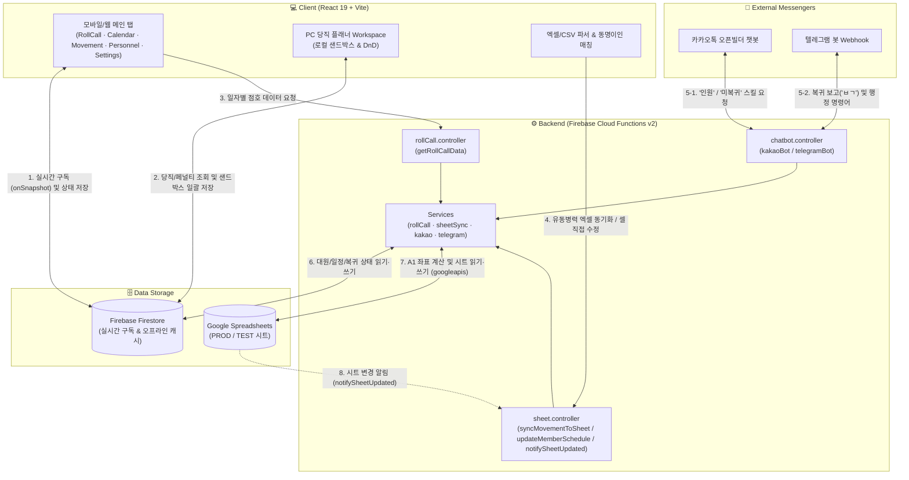

# 🎖️ NCOA Management System

**NCOA Management System**은 KATUSA 및 육군 부대 내 대원들의 **점호(Roll Call), 당직 스케줄링(Duty Planner), 유동병력(Movement), 신상 정보(Personnel)**를 통합 관리하고 자동화하는 웹 애플리케이션 및 챗봇 솔루션입니다.

클라이언트 단의 실시간 상태 구독 및 엑셀 파싱과 서버리스 백엔드(Firebase Cloud Functions, Google Sheets API, 카카오톡·텔레그램 봇)를 결합하여 부대 행정 및 점호 보고 업무를 자동화합니다.

---

## ✨ 주요 기능 (Key Features)

- **📱 스마트 점호 관리 (Roll Call)**
  - 아침/저녁 점호 인원(총원, 현재원, 열외, 외박/휴가 복귀 등) 자동 집계 및 원클릭 보고 양식 복사
  - KTA / BLC 파견 기수별 일차(`Day N`) 자동 역계산 및 일과표 시간순 자동 정렬
- **📅 일정 캘린더 & 🖥️ PC 전용 당직 플래너 (Calendar & Duty Workspace)**
  - 부대 일정, 공휴일, KTA/BLC 교육 템플릿 관리 및 당직 근무표 조회
  - `@dnd-kit` 기반 드래그 앤 드롭(DnD) 로컬 샌드박스 당직 배정 및 자동 분배
  - 평당·금일당·토당 가중치 집계, 근무 제한 브러시(Restriction Brush), 페널티 당직(`+N`) 가산 트래킹
- **📂 유동병력 관리 및 구글 시트 양방향 동기화 (Movement)**
  - 엑셀/CSV 유동병력 파일 브라우저 파싱 및 동명이인·미등록 대원 수동 매칭(Ambiguity Resolution)
  - 웹 그리드 셀 편집 및 Google Spreadsheets API 기반 실시간 시트 동기화 (PROD / TEST 모드 지원)
- **👥 대원 신상 관리 (Personnel)**
  - 입대일 및 조기진급 반영 자동 계급 계산, 전입/전출 관리, 미군 카운터파트(Runner) 분리 관리
- **🤖 메신저 봇 연동 (KakaoTalk & Telegram Bot)**
  - **텔레그램 봇**: 대원 계정 인증(`/auth`), 실시간 복귀/복귀취소 보고(`ㅂㄱ`), 미복귀자 조회 및 시카(Senior) 자동 멘션 호출, 로컬 터널 프록시(`/dev`) 지원
  - **카카오톡 챗봇**: 주간 점호 인원 현황(`인원`) 및 금일 미복귀자 명단(`미복귀`) 조회

---

## 🏗️ 시스템 아키텍처 및 데이터 흐름도 (Data Flow Diagram)



### 핵심 데이터 파이프라인
1. **실시간 상태 동기화 (`Firestore <-> Client`)**
   - 프론트엔드는 Firestore `persistentLocalCache`와 `onSnapshot`을 통해 대원 명단, 당직표, 페널티, 일정, 시트 갱신 타임스탬프를 실시간으로 구독합니다.
2. **유동병력 파싱 및 시트 동기화 (`Client -> Functions -> Google Sheets`)**
   - 클라이언트에서 엑셀 파일을 파싱한 후 `syncMovementToSheet` 또는 `updateMemberSchedule` 엔드포인트를 호출하면, 백엔드가 대원 명단을 대조(동명이인 발견 시 `ambiguous` 반환 후 수동 매칭)하여 Google Sheets의 정확한 셀(A1 주소)에 반영합니다.
3. **점호 연산 및 챗봇 자동 응답 (`Messengers / Client -> Functions -> Firestore & Sheets`)**
   - `rollCall.service`가 Firestore의 대원·일정 정보와 Google Sheets의 유동병력 데이터를 결합해 아침/저녁 점호 인원을 분류하며, 이를 웹 UI, 카카오톡(`kakaoBot`), 텔레그램(`telegramBot`)에 일관된 데이터로 제공합니다.

---

## 🛠️ 기술 스택 (Tech Stack)

| 구분 | 기술 / 라이브러리 | 용도 |
| :--- | :--- | :--- |
| **Frontend** | React 19, TypeScript, Vite 7 | SPA 프론트엔드 코어 및 빌드 환경 |
| **Styling & UI** | Tailwind CSS v3, Framer Motion, Lucide React | 반응형 스타일링, 애니메이션, 아이콘 |
| **Interaction & Data** | `@dnd-kit/core`, `xlsx` (SheetJS), `papaparse` | 당직 드래그 앤 드롭, 엑셀/CSV 로컬 파싱 |
| **Backend** | Firebase Cloud Functions v2 (Node.js 22, TS) | 서버리스 HTTPS 엔드포인트 및 웹훅 처리 |
| **Database** | Firebase Firestore, Firebase Auth | 실시간 NoSQL 데이터베이스 및 익명 인증 |
| **External APIs** | `googleapis` (Sheets API v4), `axios` | 구글 시트 양방향 연동, 카카오/텔레그램 봇 통신 |
| **Hosting** | Firebase Hosting | 정적 웹 애플리케이션 배포 |

---

## 📂 프로젝트 구조 (Project Structure)

```text
NCOA/
├── src/                          # 프론트엔드 소스 코드 (React + Vite)
│   ├── components/
│   │   ├── calendar/             # 캘린더, 당직 트래커, 페널티 당직 모달 등
│   │   ├── duty/                 # PC 전용 당직 스케줄러 워크스페이스 및 자동 분배
│   │   ├── movement/             # 유동병력 시트 그리드, 엑셀 업로드, 동명이인 매칭 모달
│   │   ├── personnel/            # 대원 및 러너(Runner) 신상 추가/편집 모달
│   │   ├── rollcall/             # 점호 현황 카드, 일정 입력, 양식 복사 컴포넌트
│   │   └── tabs/                 # 5개 메인 탭 (RollCall, Calendar, Movement, Personnel, Settings)
│   ├── hooks/                    # 도메인별 커스텀 훅 (calendar, duty, member, movement, rollcall)
│   ├── lib/                      # Firebase 클라이언트 초기화 및 설정
│   ├── types/                    # 전역 TypeScript 타입 및 인터페이스
│   └── utils/                    # 날짜, 계급 계산, 당직 분배, 점호 파서 유틸리티
│
├── functions/                    # 백엔드 소스 코드 (Firebase Cloud Functions v2)
│   └── src/
│       ├── config/               # Firebase Admin 초기화 및 CORS 설정
│       ├── controllers/          # HTTPS 엔드포인트 (rollCall, sheet, chatbot)
│       ├── repositories/         # Firestore 및 Google Sheets 데이터 접근 계층
│       ├── services/             # 비즈니스 로직 (rollCall, sheetSync, kakao, telegram)
│       └── utils/                # KST 날짜 변환, 계급 포맷, 시트 좌표(A1) 계산 유틸
│
├── firebase.json                 # Firebase Hosting, Functions, Emulators 설정
└── package.json                  # 프론트엔드 의존성 및 스크립트
```

---

## 🚀 시작하기 (Getting Started)

### 1. 사전 요구사항 (Prerequisites)
- **Node.js**: v22 이상 권장
- **Firebase CLI**: `npm install -g firebase-tools`
- **인증 키 설정**: Google Sheets API 연동 및 Firebase Admin 구동을 위한 서비스 계정 권한 및 환경 변수(`functions/.env`) 설정

### 2. 설치 및 로컬 실행

#### 프론트엔드 (Frontend)
```bash
# 루트 디렉토리에서 의존성 설치
npm install

# Vite 로컬 개발 서버 실행 (http://localhost:5173)
npm run dev
```

#### 백엔드 (Firebase Functions Emulator)
```bash
# functions 디렉토리 이동 및 의존성 설치
cd functions
npm install

# TypeScript 빌드 및 로컬 에뮬레이터 실행 (Port: 5001)
npm run serve
```

### 3. 빌드 및 배포 (Build & Deployment)

```bash
# 1) 프론트엔드 빌드 및 Firebase Hosting 배포
npm run build
firebase deploy --only hosting

# 2) 백엔드 Cloud Functions 배포
cd functions
npm run deploy
```
