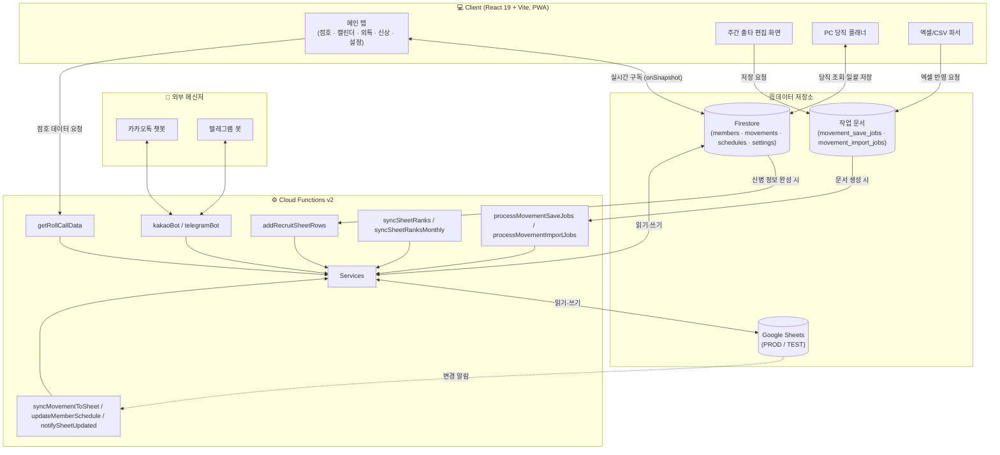

# 🎖️ NCOA Senior KATUSA

NCOA KATUSA의 **점호, 당직, 유동병력(외박·휴가·잔류), 신상 정보**를 관리하는 웹 앱(PWA)과 챗봇입니다. Firebase(Firestore, Cloud Functions, Hosting)와 Google Sheets를 함께 사용합니다.

## ✨ 주요 기능

- **점호**: 아침/저녁 점호 인원 자동 집계, 보고 양식 복사, KTA/BLC 기수 일차 계산
- **캘린더·당직**: 부대 일정·공휴일·교육 템플릿 관리, PC용 드래그 앤 드롭 당직 플래너와 자동 분배
- **외특(유동병력)**: 주간 출타 편집, 엑셀 반영, 패스지 작성, Google Sheets 동기화 (저장은 서버 작업으로 처리)
- **신상**: 입대일·조기진급 기준 계급 자동 계산, 전입 예정 신병 관리 (정보가 채워지면 시트에 자동 추가)
- **챗봇**: 텔레그램(복귀 보고, 미복귀자 조회), 카카오톡(인원 현황, 미복귀자 조회)

## 🛠️ 기술 스택

- **Frontend**: React 19, TypeScript, Vite, Tailwind CSS
- **Backend**: Firebase Cloud Functions v2 (Node.js 22), Firestore, Firebase Auth
- **External**: Google Sheets API, Telegram / Kakao 봇
- **Deploy**: Firebase Hosting, GitHub Actions

## 🏗️ 아키텍처



### 데이터 흐름
1. **실시간 동기화**: 앱은 Firestore를 `onSnapshot`으로 구독해 인원, 출타 기록, 일정, 저장 작업 상태를 실시간으로 보여 줍니다.
2. **주간 출타 저장**: 편집 화면은 `movement_save_jobs`에 요청을 쓰고 바로 닫힙니다. `processMovementSaveJobs`가 시트를 먼저 쓰고 Firestore 기록을 맞추며, 실패하면 이유를 남겨 앱에서 다시 시도할 수 있습니다.
3. **엑셀 반영**: 앱에서 파싱한 결과를 `movement_import_jobs`로 보내면 `processMovementImportJobs`가 시트와 기록을 함께 반영합니다. 경고가 있으면 아무것도 쓰지 않습니다.
4. **전입 예정 신병**: 시트에 행이 없는 신병의 출타는 따로 보관합니다. 이름·영문 이름·전화번호가 채워지면 `addRecruitSheetRows`가 시트에 행을 추가하고 보관한 출타를 반영합니다.
5. **점호·챗봇**: `rollCall.service`가 Firestore와 시트 데이터를 합쳐 점호 인원을 계산하고, 웹·카카오톡·텔레그램에 같은 결과를 제공합니다.

## 📂 프로젝트 구조

```text
NCOA/
├── src/          # 프론트엔드 (components, hooks, utils, lib, types)
├── functions/    # Cloud Functions (controllers, services, repositories, utils)
├── tests/        # 단위 테스트
├── scripts/      # 시트 마이그레이션 스크립트
└── firebase.json
```

## 🚀 시작하기

### 요구사항
- Node.js 22+
- Firebase CLI (`npm install -g firebase-tools`)
- Google Sheets 연동용 서비스 계정과 `functions/.env`

### 로컬 실행

```bash
npm install
npm run dev          # http://localhost:5173
```

```bash
cd functions
npm install
npm run serve        # Functions 에뮬레이터
```

### 테스트

```bash
npm test
```

### 배포

`main`에 머지하면 GitHub Actions가 Hosting과 Functions를 자동 배포합니다. 수동 배포:

```bash
npm run build && firebase deploy --only hosting
cd functions && npm run deploy
```

- 함수 탐색이 시간 초과되면 `FUNCTIONS_DISCOVERY_TIMEOUT=60`을 붙여 배포합니다.
- 저장·엑셀 작업 형식이 바뀌면 앱과 함수를 함께 배포해야 합니다.
- CI 서비스 계정에는 Hosting·Functions 배포 권한 외에 Cloud Scheduler(예약 작업), Eventarc(Firestore 트리거), Cloud Datastore 읽기 권한이 필요합니다.
